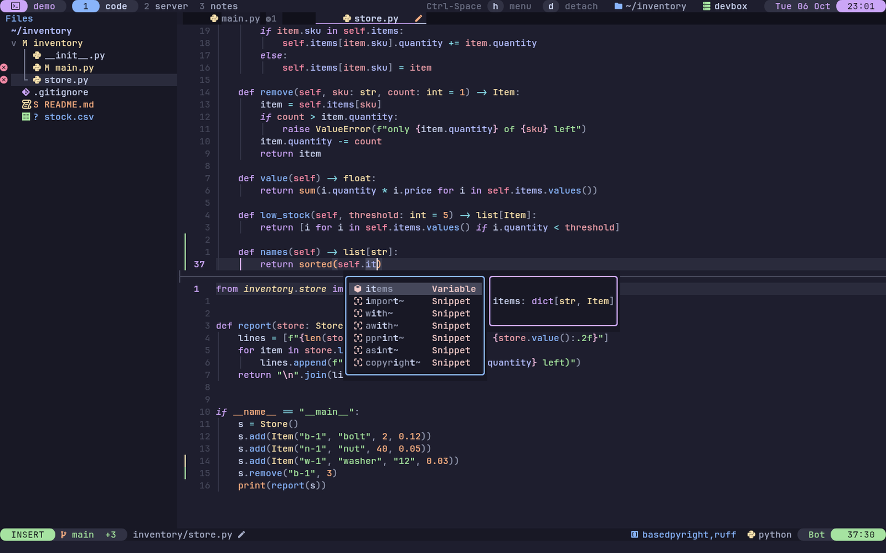
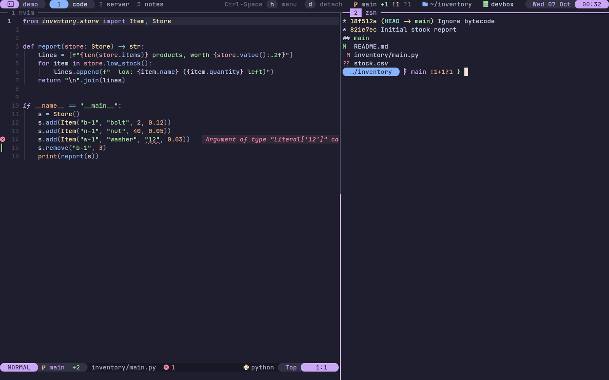
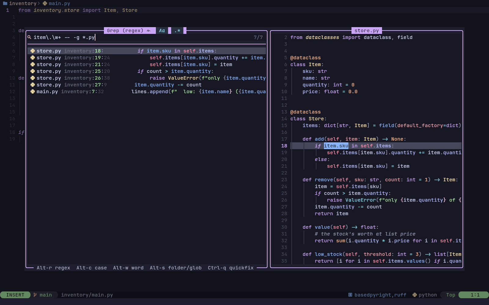
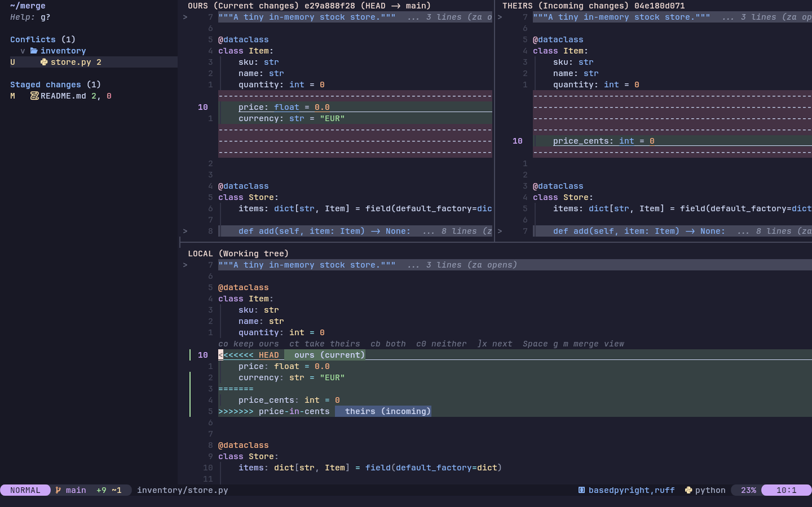
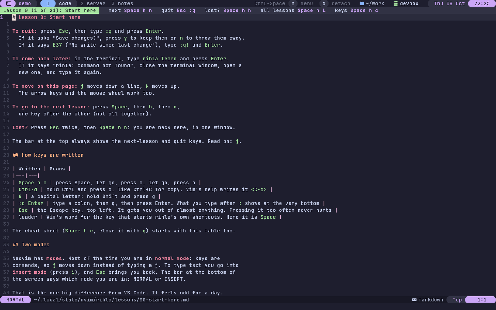

<p align="center"></p>

# rihla

Neovim + tmux for people coming from VS Code. One command installs a pinned
Neovim, its plugins and a matching tmux into your home directory, without root,
on anything from CentOS 7 to a current laptop. Lessons are built in.

It is for someone who knows VS Code and has never used Vim or tmux, or tried and
got stuck: on a laptop, or on a remote server where you have no root and an old
system. The editor keeps VS Code's habits where it can (find a file, search the
project, a file tree, tabs, a command palette, Ctrl-s), and the lessons teach
the Vim way one step at a time.

## Features

- **One install, no root.** Neovim, ripgrep, fd, fzf, lazygit and, on Linux
  when the system's is older than 3.2, tmux go into your home directory, each at
  an exact, sha256-checked version. A Neovim built for glibc 2.17 is used on
  older systems.
- **Lessons inside the editor.** 21 short lessons over six weeks, from "how do I
  quit" to macros and `:g`. Each is one page you practise on in place; your copy
  saves itself, `Space h r` gives a fresh one, and progress survives updates.
- **Keys you can discover.** Press `Space` and wait: a popup lists every key that
  can follow, with a description. `Space Space` is a command palette, and the
  cheat sheets open inside the editor.
- **Hints, not traps.** Arrows, the mouse and repeated keys all work. After a run
  of slow presses, a one-line hint names the faster motion and the lesson that
  teaches it, and only motions from lessons you have finished.
- **Languages set up on first open.** Opening a Python, Go, Rust, C, JavaScript,
  Lua, shell, HTML, CSS, JSON, YAML, TOML, Markdown, Docker, SQL or Java file
  installs its language server and formatter in the background, and its
  tree-sitter parser when a C compiler is present:
  completion, go to definition, rename, problems inline, format on demand.
- **The rest of the IDE.** Replace across files with a preview, git changes in
  the gutter and lazygit, a three-way merge view and in-file conflict keys, a
  debugger on `F5`/`F9`/`F10`/`F11`, terminals at the bottom or floating.
- **tmux that matches.** The same colours and mode tiles as the editor,
  `Ctrl-h/j/k/l` across editor splits and tmux panes alike, and copy that reaches
  your own clipboard over SSH.
- **A shell to match, opt in.** `rihla shell` adds suggestions from history,
  fzf on Ctrl-R and Ctrl-T, folder jumps with zoxide and a prompt, for zsh or
  bash; `--off` removes it.
- **Easy to leave.** Your existing configs are backed up, `rihla uninstall` puts
  them back, and your own settings live in `~/.config/rihla/`, which install,
  update and uninstall leave alone.

## Install

```sh
curl -fsSL https://raw.githubusercontent.com/ZahakJ/rihla/main/install.sh | sh
```

No curl: `wget -qO- https://raw.githubusercontent.com/ZahakJ/rihla/main/install.sh | sh`.
Options go after `sh -s --`, e.g. `| sh -s -- --icons nerd --shell`. Behind a proxy,
set `https_proxy` first. For a machine without network, `rihla bundle` builds an
[offline bundle](docs/install.md#offline-machines).

<p align="center">
  
  
</p>
<p align="center">
  
  
</p>

## First run

1. Open a new terminal (or `export PATH="$HOME/.local/bin:$PATH"`).
2. `rihla learn` opens lesson 0. To quit: `Esc`, then `:q`, Enter. The bar at
   the top shows the keys for the next lesson and for getting back. Keys written
   `Space h n` are pressed one after another: Space, let go, `h`, let go, `n`.
   Neovim opens in Normal mode, where letters are commands: `i` starts typing
   text, `Esc` stops.
3. Lost (a second window, a popup, typing in the wrong place)? `Esc` twice, then
   `Space h h`.
4. `nvim` opens the start screen. Press `Space` and wait: a popup lists every key
   that can follow. `q` or `Esc` closes any popup.
5. `tmux new -s work` starts tmux. `Ctrl-Space h` is a menu of tmux actions,
   `Ctrl-Space d` leaves tmux running in the background, `tmux attach` comes back.

`rihla check` says what works on this machine and what to fix.

## Requirements

- Linux with glibc 2.17+ (CentOS 7 and up), x86_64 or arm64; or macOS.
- `sh`, `tar`, `gzip`, `sed`, `awk`, `curl` or `wget`, and `sha256sum`, `shasum`
  or `openssl`.
- Optional: git 2.19+ (otherwise plugins come as tarballs), a C compiler
  (tree-sitter parsers), `unzip`, Node.js and Python 3 with `venv` (some
  language servers).
- A true-colour terminal. A [Nerd Font](https://www.nerdfonts.com/) for icons;
  without one rihla uses plain characters.

## Usage

```
rihla install       install or repair; safe to re-run
rihla update        move rihla, its tools and plugins to the current pins
rihla uninstall     remove everything and restore the previous config
rihla check         check versions, PATH, clipboard, colours, icons, plugins
rihla learn         open your current lesson (next, prev, list, reset, N)
rihla cheat         cheat sheets for nvim and tmux
rihla icons         nerd, ascii or auto
rihla shell         prompt, suggestions, fzf keys for zsh or bash (--off to undo)
rihla bundle        build a tarball for a machine without network
```

## Keys

Leader is `Space`. Vim's own keys are left alone. Full lists:
[Neovim](docs/cheatsheet-nvim.md) (`Space h c`), [tmux](docs/cheatsheet-tmux.md)
(`Ctrl-Space H`).

| Key | Does |
| --- | --- |
| `Space f f` or `Ctrl-p` | find a file |
| `Space f g` | search text in the project |
| `Space r p` / `Space r r` | replace across files / in this file |
| `Space e` | file tree |
| `Alt-1`..`Alt-9`, `Space b b` | go to tab N, pick an open file |
| `Space Space` | command palette |
| `Ctrl-s` | save |
| `K`, `gd`, `grr`, `grn`, `gra` | hover, definition, references, rename, code action |
| `]d` `[d`, `Space x x` | next / previous problem, problem list |
| `Space l f` | format |
| `Space g g` | lazygit |
| `F5`, `F9`, `F10`, `F11` | debug: continue, breakpoint, step over, step into |
| ``Ctrl-\``, `Space t t` | terminal at the bottom, floating terminal |
| `]x`, `co` `ct` `cb` `c0`, `Space g m` | merge conflicts: next, ours / theirs / both / none, 3-way view |
| `Ctrl-h/j/k/l` | move between splits and tmux panes |
| `Space h l` / `Space h n` / `Space h h` | current lesson / next lesson / back to the lesson |
| `Space h v` | VS Code to Neovim table |

| tmux | Does |
| --- | --- |
| `Ctrl-Space` (or `Ctrl-b`) | prefix: press it, let go, then the key |
| `prefix \|` / `prefix -` | split side by side / top and bottom |
| `prefix c`, `prefix 1..9` | new window, go to window |
| `prefix z` | zoom the pane |
| `prefix [`, then `v`, `y` | copy mode: select, copy (also over SSH) |
| `prefix d` | detach |
| `prefix h` / `prefix H` | menu / cheat sheet |

[VS Code to Neovim](docs/vscode-to-neovim.md) maps the rest. Lesson 7b covers the
VS Code habits on practice files.

## Your own settings

Never edit the installed files; `rihla update` replaces them. Put yours in
`~/.config/rihla/`, which install, update and uninstall leave alone:

| File | Loaded |
| --- | --- |
| `local.lua` | last: options, keymaps, autocommands |
| `init.lua` | first, before plugins |
| `plugins/*.lua` | lazy.nvim plugin specs, added to rihla's |
| `langs.lua` | merged over the language table ([langs.lua](nvim/lua/rihla/langs.lua)) |
| `tmux/local.conf` | last in tmux |
| `icons` | `nerd` or `ascii` |

```lua
-- ~/.config/rihla/local.lua
vim.opt.relativenumber = false
vim.keymap.set("n", "<leader>j", "<cmd>noh<CR>", { desc = "Clear search highlight" })
```

## How it works

- `install.sh` copies rihla to `~/.local/share/rihla` and runs `bin/rihla install`,
  a POSIX `sh` installer.
- Tools come from `lib/manifest`: exact versions, sha256-checked, with a glibc 2.17
  Neovim build for older systems. Plugins are pinned by `nvim/lazy-lock.json` and
  fetched as tarballs where git is too old.
- `~/.config/nvim` links to the Neovim config; `~/.tmux.conf` sources the tmux config.
  Both draw from one palette, `tmux/palette.conf`.
- On the first file of a language, `lang.lua` looks it up in `langs.lua`: a server on
  `PATH` is used as it is, otherwise mason installs one into your home and runs it
  once to prove it starts on this glibc before enabling it.
- tmux's `Ctrl-h/j/k/l` checks whether the pane is running nvim or fzf and passes
  the key through if so; at the edge of nvim, vim-tmux-navigator hands it back.
- Every change is journalled: an existing config is backed up, and `rihla uninstall`
  puts it back.

## Documentation

- [Architecture](docs/ARCHITECTURE.md): installer, pins, journal, plugin provisioning,
  the Neovim and tmux configs, tests
- [Install reference](docs/install.md): what goes where, options, offline, proxies,
  troubleshooting
- [Neovim](docs/nvim.md): plugins, languages, customising
- [The shell layer](docs/shell.md)
- [VS Code to Neovim](docs/vscode-to-neovim.md), cheat sheets for
  [Neovim](docs/cheatsheet-nvim.md) and [tmux](docs/cheatsheet-tmux.md),
  [lessons](docs/learn/README.md)

## License

MIT
